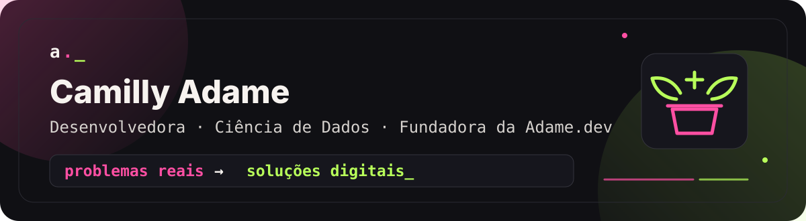

 

## `sobre_`

Sou desenvolvedora full-stack e estudante de **Ciência de Dados na Univesp**. Construo sistemas web de ponta a ponta, do modelo de dados à interface, e hoje tenho **dois sistemas em uso por negócios reais**.

Gosto de entender como um processo funciona e transformar isso em regras de negócio no servidor, banco relacional bem modelado e uma interface que a equipe consegue usar no dia a dia. Agora estou aprofundando dados e machine learning.

- 🔭 **Procurando:** vaga como desenvolvedora
- 🌎 **Formato:** remoto, híbrido ou mudança de cidade (residência disponível em São José do Rio Preto — SP)
- 🗣️ **Idiomas:** português nativo, inglês básico (em estudo)
- 📍 Presidente Epitácio — SP

---

## `projetos_`

### [ADA Repair](https://adamedev.com.br/projetos/ada-repair) · sistema de gestão · `em uso`

Sistema interno de uma assistência técnica de celulares. Substituiu os registros em papel da loja por um sistema central com acesso remoto.

- Banco relacional com 12 entidades em **Prisma + PostgreSQL**
- Ordem de serviço com 8 estados, checklist de entrada, fotos e orçamento
- Perfis de acesso (admin e técnico) verificados no servidor com **NextAuth**
- QR code por ordem e página pública para o cliente acompanhar o conserto

`Next.js` `TypeScript` `PostgreSQL` `Prisma` `NextAuth` `Cloudinary` · código privado (o sistema está em uso e o acesso é restrito por segurança) · [estudo de caso ↗](https://adamedev.com.br/projetos/ada-repair)

### [Studio CM](https://github.com/camillyadame/StudioCM) · agendamento online · `no ar`

Site de um estúdio de beleza com agendamento integrado ao **Google Calendar** das duas profissionais.

- API em **Node.js/Express** que calcula horários livres a partir das agendas reais
- Pré-reservas que expiram sozinhas se o sinal não for confirmado
- Rate limiting, campo-isca e validação contra abuso, com testes automatizados

`React` `TypeScript` `Vite` `Node.js` `Express` `Google Calendar API` · [ver no ar ↗](https://studio-cm.vercel.app/) · [estudo de caso ↗](https://adamedev.com.br/projetos/studio-cm)

### [adame.dev](https://github.com/camillyadame/adame-dev) · portfólio

Meu portfólio em **Next.js + Tailwind CSS**, com hero ASCII gerado em canvas, animações ligadas à rolagem e currículo gerado a partir dos mesmos dados.

### em construção

- **SEIVA** · plataforma de estudos com IA e gamificação
- **FoodWise AI** · análise e previsão de demanda com Python, Pandas e scikit-learn

---

## `stack_`

**Frontend**  

**Backend & dados**  

**Estudando**  

**Ferramentas**  

---

`a._` · [adamedev.com.br](https://adamedev.com.br) · [linkedin](https://www.linkedin.com/in/camilly-adame) · cadame.dev@gmail.com

